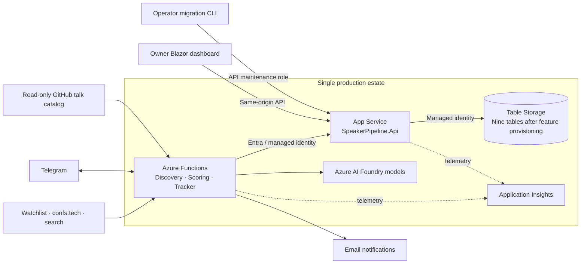

# Speaking Pipeline — Agents

A personal speaking pipeline and public AgentOps reference: discover opportunities,
score their fit, reconcile submissions, and surface decisions through Telegram and
email. The implementation runs on .NET, Azure Functions, an App Service API, and
Azure AI Foundry models.

## One production environment

The existing deployed API and Functions host are the single production estate.
Physical resource names ending in `dev` are historical and stay in place; they
do not represent a second environment. Development and fictional samples belong
in local, isolated storage. No dev-to-prod promotion or replacement Azure stack
is required.

Follow the [production rollout runbook](docs/production-rollout.md) and the
[deployment plan](.azure/deployment-plan.md) for release gates, the maintenance
window, data cleanup, validation, and recovery. A repository change alone does
not establish that the production cutover has passed its acceptance checks.

## Architecture



Every consumer reaches data through the API. The API owns `Events`, `Submissions`,
`Talks`, `Topics`, `Blackouts`, `NotificationLog`, `Opportunities`, `Catalog`, and
`Operations`. Feature-gated migration makes Opportunities authoritative and
retains Events as a frozen recovery baseline. Agents have API access and
model access; they do not need direct pipeline Table Storage access.

The agent projects use the Microsoft Agent Framework ecosystem and
`Microsoft.Extensions.AI.IChatClient`; **Azure Functions hosts the workload** and
Foundry supplies model inference. MCP code exists in the repository but is not
part of the deployed production footprint. OpenClaw and calendar integrations
remain future work.

## Build and local development

Use the .NET SDK pinned in `global.json` and dependency versions in
`Directory.Packages.props`.

```powershell
dotnet restore SpeakerPipeline.slnx
dotnet build SpeakerPipeline.slnx --configuration Release --no-restore
dotnet test SpeakerPipeline.slnx --configuration Release --no-build
```

Configure a local API with loopback Azurite using the settings example in
`src/SpeakerPipeline.Api`. The [migration CLI](tools/SpeakerPipeline.Migrate/README.md)
previews imports by default and permits fictional samples only against loopback:

```powershell
dotnet run --project tools/SpeakerPipeline.Migrate -- samples --source samples --api http://localhost:5080/
```

The old `scripts/seed-tables.ps1` entrypoint is retired and fails immediately.
Keep real imports, snapshots, cleanup manifests, and journals outside Git. Do not
seed the production system from `samples/`.

## Current capabilities

- Discovery and URL ingestion, confidence-based quarantine, scoring, and
  deterministic tracker reconciliation/conflict checks.
- Telegram commands plus email/Telegram digests and urgent deadline notices;
  notification history supports deduplication. No automatic organizer submissions.
- Entra roles, managed identities, readiness checks, and OpenTelemetry to
  Application Insights.
- Blocking solution tests/evals and manual production releases of CI artifacts.
- Role-protected snapshot export, conservative cleanup, resumable journals,
  selective rollback, and local full-backup restore rehearsal.
- Feature-gated shared opportunity actions, owner dashboard, read-only talk
  catalog, calibrated scoring and explicit feedback. These require the
  [actionable pipeline activation procedure](docs/actionable-pipeline-rollout.md).

## Documentation

- [Architecture overview](docs/architecture-overview.md)
- [Authoritative Table Storage schema](docs/architecture-table-storage.md)
- [Actionable pipeline activation](docs/actionable-pipeline-rollout.md),
  [notifications](docs/actionable-notifications.md), and [talk catalog](docs/talk-catalog.md)
- [Production rollout](docs/production-rollout.md) and [infrastructure](infra/README.md)
- [Migration CLI](tools/SpeakerPipeline.Migrate/README.md) and [fictional samples](samples/README.md)
- [Architecture decisions](docs/adr/), [contributing](CONTRIBUTING.md), and [security](SECURITY.md)

## License

Apache 2.0 — see [LICENSE](LICENSE) and [NOTICE](NOTICE).
