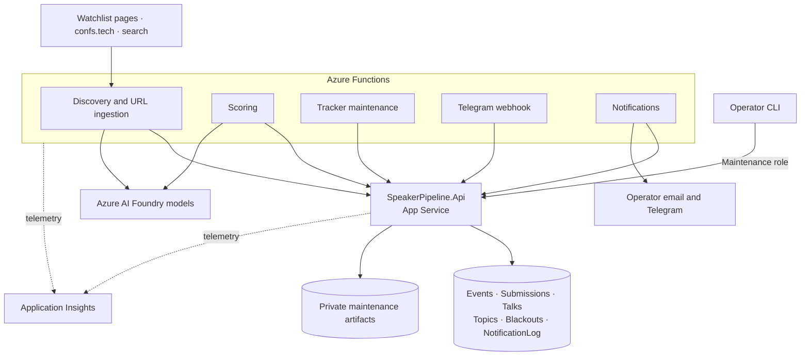

# Architecture overview

The speaking pipeline has one logical production environment: the existing API
App Service and Azure Functions host. Historical `dev` resource names remain
unchanged. Local development is isolated from production data. See the
[production runbook](production-rollout.md), [deployment plan](../.azure/deployment-plan.md),
and [six-table schema](architecture-table-storage.md).

## Runtime and boundaries

The .NET agent projects use the Microsoft Agent Framework ecosystem through
`Microsoft.Extensions.AI.IChatClient`. Functions provides scheduled/manual
execution; Foundry supplies models. The workload is not hosted in Foundry Agent
Service. Every read and write by agents, Telegram, or operator tooling goes
through the API. Only the API references Storage.

The MCP host exists in source as an API adapter but is not deployed. OpenClaw,
external calendar connectors, and automated organizer submissions are future
capabilities, outside this production cutover.

## Implemented flows

| Component | Behavior | Normal trigger |
|---|---|---|
| Discovery | Reads watchlist/confs.tech/search sources, extracts and reconciles events, quarantines weak candidates | Daily 05:00 UTC; manual HTTP |
| URL ingestion | Extracts an explicitly supplied URL through the discovery pipeline | HTTP and Telegram `/track` |
| Tracker maintenance | Derives event categories from submissions, calculates blackout/preparation conflicts, finds urgent deadlines | Daily 05:30 UTC; manual HTTP |
| Scoring | Reads event candidates and pipeline context, records model recommendations through the API | Monday 06:00 UTC; manual HTTP |
| Telegram | Reports status, captures topics, ingests URLs, promotes candidates, and records intent/pass decisions | Secret-validated webhook and configured chat |
| Notifications | Sends run digests and urgent notices to configured operator destinations; records deliveries for deduplication | Agent run results |

These schedules operate independently; their ordering is not a durable workflow
transaction. Discovery verification/extraction occurs inside the discovery flow,
not in a separately deployed verification agent. Tracker maintenance currently
updates event status/conflict flags; it does not infer delivered talks or increment
talk delivery counts. `/approve` records intent to submit, not a completed
submission to an organizer.

Manual run triggers can write data and send notifications. Empty scheduled-run
suppression does not disable urgent notices. Notification history is operational
state and must survive cleanup unless exact rows are explicitly reviewed.

## Identity, operations, and recovery

The API validates Entra tokens and requires `Pipeline.Access` for ordinary
operations. Functions uses managed identity for the API and model access; the
API identity owns Table Storage access. Do not grant agent identities direct
pipeline table access. Telegram additionally requires its shared webhook secret
and configured chat; manual Function endpoints require function keys.

`/health` reports API liveness. Protected `/health/ready` exercises all six data
tables. Functions exposes a key-protected readiness check that does not run
agents or send notifications. OpenTelemetry and Application Insights support
runtime investigation; release acceptance also verifies telemetry arrival.

Production releases are manual and consume successful CI artifacts. The release
workflow preserves pause controls. The cutover freezes ordinary API writes and
pauses Functions/MCP/manual writers and notification lanes before export and
cleanup. The API's separately authorized maintenance surface exports raw typed
entities, validates snapshot/target/ETag bindings, and journals selective changes
before mutation. Restore handles touched rows or a full backup rehearsal in
isolated loopback storage. Unknown properties and orphan rows are preserved in
exports; ordinary domain projections are not backups.

See the [migration CLI](../tools/SpeakerPipeline.Migrate/README.md) for exact
commands and the [runbook](production-rollout.md) for acceptance and rollback.
